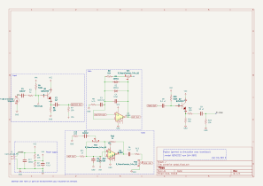
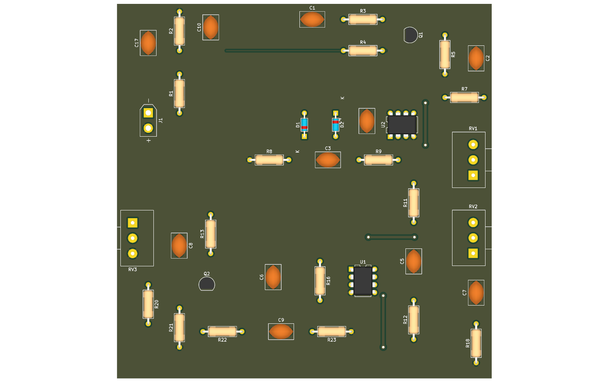

# Guitar overdrive pedal

An overdrive pedal for electric guitar, designed in KiCad and simulated with ngspice. I built it for the end-of-year
project of my first year of the BUT in Networks & Telecommunications (IUT Auxerre, June 2024), then soldered and
tested it on a real PCB.

The design follows the classic Tube Screamer architecture. ElectroSmash has a
[detailed analysis of the original circuit](https://electrosmash.com/tube-screamer-analysis). I rebuilt it with
parts I could find at school: TL081 op-amps instead of the JRC4558, 2N2222 transistors instead of the 2SC1815, and
1N914 diodes instead of the MA150.



## How it works

The signal goes through five blocks, each one marked on the schematic:

1. **Input buffer.** Q1 (2N2222) is an emitter follower. It gives the guitar a high input impedance so the pickups
   are not loaded.
2. **Gain stage.** U2 (TL081) is a non-inverting amplifier. Two 1N914 diodes in anti-parallel in its feedback loop
   clip the signal softly, which creates the overdrive sound. RV1 sets the amount of distortion.
3. **Tone stage.** U1 (TL081) with RV2 sets how much treble goes through.
4. **Level and output buffer.** RV3 sets the output volume, and Q2 (2N2222) drives the output.
5. **Power supply.** The pedal runs from a 9 V supply on J1 (XT30 connector). R1 and R2 make a 4.5 V reference
   (VAA) so the op-amps can swing around half the supply, and C17 and C10 filter the rails.

## Simulation

The schematic is set up for the KiCad simulator (ngspice): a 20 mV, 440 Hz sine source as the guitar
(`Vinput1`), and a transient analysis `.tran 10u 50m`. The 2N2222 model is written directly in the schematic
(`.model Q2N2222 npn (bf=350)`).

The TL081 and 1N914 models are not in this repository because they belong to their manufacturers. To run the
simulation, download them and place them in `hardware/` with these names:

- `TL081.301`: TL081 PSpice model from [Texas Instruments](https://www.ti.com/product/TL081)
- `1N914.LIB`: 1N914 SPICE model (from the manufacturer of your diode, for example onsemi)

Run an operating-point analysis first to check the DC voltages before the transient analysis.

## PCB

Single board with through-hole parts only (DIP-8 op-amps, TO-92 transistors, axial resistors), so it can be
soldered by hand.



Exports in `docs/`: schematic (PDF and SVG), PCB layers (SVG), 3D view and bill of materials (`bom.csv`).

## Known issues

This was a first-year student project. The KiCad checks still report a few real problems to fix before ordering a
new board: 7 dangling track ends, 1 copper-to-edge clearance error, some silkscreen overlaps, and a few pins flagged
as not driven in the schematic. Most of the other warnings come from library differences between KiCad versions.

## Files

```
hardware/   KiCad project (open overdrive-pedal.kicad_pro with KiCad 8 or later)
docs/       schematic and PCB exports, bill of materials
```

## Author

Antoine Blondeau, now an embedded systems engineering student at ENSTA.
